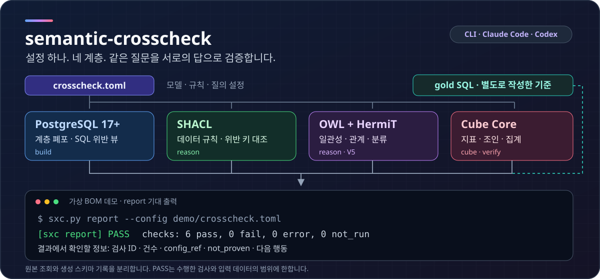
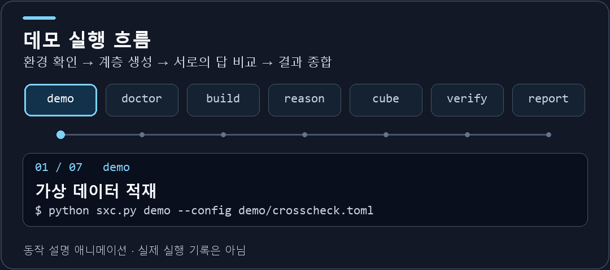
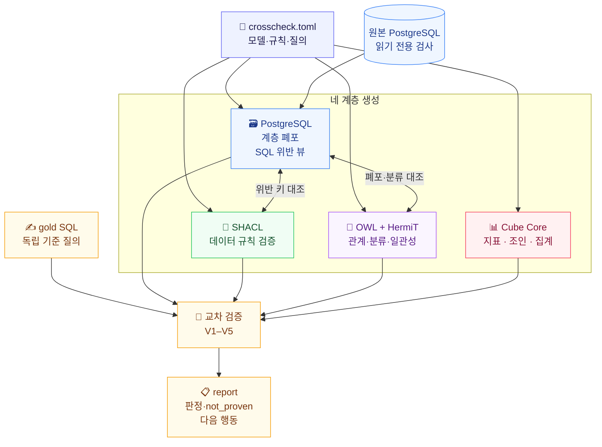
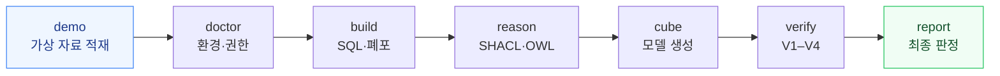
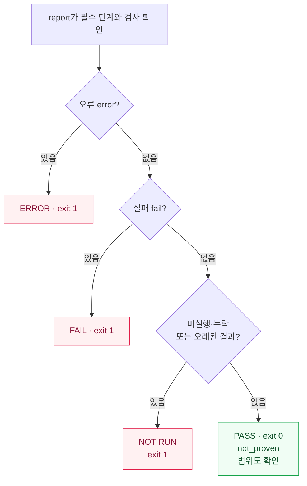

<div align="center">

# semantic-crosscheck

### PostgreSQL · 온톨로지 · 시맨틱 레이어, 같은 질문에 같은 답을 내는가?

**설정 하나에서 네 계층을 만들고, 서로의 결과를 교차 검증합니다.**<br/>
계층마다 그럴듯한 설명을 넘어, **검사 ID · 건수 · 종료 코드로 일치 여부를 확인합니다.**

[](docs/releases/v0.8.0.md)
[](https://github.com/Technoetic/semantic-crosscheck/actions/workflows/tests.yml)
[](LICENSE)
[](#claude-code)
[](#codex)

[](#requirements)
[](#requirements)
[](#requirements)
[](#verification)

<br/>



<sub>구조와 터미널 출력은 가상 BOM 데모를 설명하는 그림입니다. 검증의 실제 범위와 결과는 릴리스 근거에서 확인합니다.</sub>

<br/><br/>



<sub>약 11초 동안 반복되는 동작 설명 애니메이션입니다. 실제 실행 기록이 아니며, 위 정적 도식과 아래 표에서도 같은 흐름을 확인할 수 있습니다.</sub>

<br/><br/>

**[빠른 시작](#quick-start-with-the-demo) · [설치](#install) · [단계별 명령](#stages) · [결과 읽기](#reading-results) · [검증 한계](#limitations-and-not-proven)**

</div>

---

<a id="overview"></a>
## ⚡ 30초 안에 이해하기

부품·BOM·주문·재고를 SQL, 데이터 규칙, 온톨로지, 시맨틱 레이어로 표현하면 같은 업무를 여러 언어로 설명하게 됩니다. **각 계층이 따로 통과해도, 서로 같은 답을 낸다는 보장은 없습니다.**



> [!IMPORTANT]
> **`report`가 최종 판정입니다.** 필요한 검사가 실행되지 않았거나 오래된 결과이면 통과하지 않습니다. `PASS`와 함께 표시되는 `not_proven`도 읽어야 검증 범위를 알 수 있습니다.

| 한눈에 보는 구성 | 내용 |
|---|---|
| **입력** | `crosscheck.toml` + 원본 테이블 + 독립적으로 작성한 gold SQL |
| **생성** | PostgreSQL 계층 폐포·SQL 뷰, SHACL shapes, OWL 온톨로지, Cube 모델 |
| **실행** | CLI `sxc.py` · Claude Code `/xc-*` · Codex 플러그인 |
| **출력** | 검사 ID·건수·상태·수정할 설정 항목·검증하지 못한 범위 |
| **수정 지점** | 생성된 SQL·YAML 대신 **`crosscheck.toml`**을 수정하고 다시 실행 |

<details>
<summary><b>🧭 목차 전체 펼치기</b></summary>

- [왜 계층 간 교차 검증이 필요한가](#why-cross-layer-verification)
- [온톨로지와 시맨틱 레이어의 역할](#layers)
- [V1–V5가 비교하는 것](#verification)
- [실행 환경](#requirements)
- [Claude Code · Codex 설치](#install)
- [데모 빠른 시작](#quick-start-with-the-demo)
- [단계·옵션·종료 코드](#stages)
- [판정과 not_proven 읽기](#reading-results)
- [검사 ID 목록](#check-catalogue)
- [보안 모델](#security-model)
- [문제 해결](#troubleshooting)
- [검증 한계](#limitations-and-not-proven)
- [제거](#uninstall) · [개발](#development) · [라이선스](#license)

</details>

---

<a id="why-cross-layer-verification"></a>
## 🎯 왜 교차 검증인가

대시보드의 필터, SQL 보고서의 조인, SHACL의 데이터 규칙, OWL의 관계 정의가 조금씩 어긋날 수 있습니다. 조인 때문에 건수가 늘거나, NULL 처리 방식이 다르거나, 계층을 특정 깊이에서 잘라 버려도 각 계층의 자체 테스트는 통과할 수 있습니다.

semantic-crosscheck는 같은 질문의 **서로 다른 표현을 비교**합니다. 불일치가 나오면 데이터·모델·기준 질의를 점검하고, 검사에 표시된 `config_ref`를 따라 설정을 고칩니다. 공통 설정이나 gold SQL 자체의 오류까지 자동으로 증명하는 것은 아니므로, 기준 질의를 별도로 작성하는 일이 중요합니다. 0.8.0 이후(미출시) `expect`는 업무 명세에서 쓴 기대 행과 gold SQL·Cube를 작은 fixture에서 함께 비교해, 두 쪽이 공유하는 실수의 일부를 잡습니다.

<a id="layers"></a>
### 네 계층의 역할

| 계층 | 실생활에 가까운 역할 | 구현 · 검사 단계 |
|---|---|---|
| 🗃️ **PostgreSQL** | 부품 대장과 조립 관계를 보관하고, 어떤 하위 부품이 얼마나 필요한지 계산 | PostgreSQL 17, `WITH RECURSIVE`, `CYCLE`, `MERGE ... RETURNING merge_action()` · `build` |
| 📏 **SHACL** | 대장에 적힌 값이 정한 형식과 규칙을 지켰는지 점검 | SQL 위반 뷰 ↔ pySHACL의 위반 대상 키 · `build`, `reason` |
| 🧠 **OWL · HermiT** | 부품의 종류·관계·분류와 양립할 수 없는 조건을 정의하고 추론 | OWL 2 클래스·공리, owlready2를 통한 HermiT · `reason` |
| 📊 **Cube Core** | 같은 지표·조인·필터 기준으로 업무 질문에 답하도록 조회 모델을 제공 | Cube 데이터 모델, 127.0.0.1의 로컬 어댑터 · `cube`, `verify` |

**온톨로지**는 개념·관계·분류의 의미를 설명하고, **시맨틱 레이어**는 조회할 지표와 계산 기준을 설명합니다. 이 도구는 지원하는 모델을 생성하고 둘 사이의 일치를 검사합니다. 온톨로지 설계, 원본 데이터 자동 정정, BI 화면 제공은 별도의 작업입니다.

<details>
<summary><b>📚 처음 보는 약어와 용어</b></summary>

| 용어 | 풀네임 · 뜻 | 여기서 쓰는 방식 |
|---|---|---|
| CTE | Common Table Expression · 공통 테이블 표현식 | 재귀 CTE로 계층 관계를 조회하고 순환을 검출 |
| RDF | Resource Description Framework · 자원 기술 프레임워크 | 주어·관계·목적어 형태로 검증용 데이터를 표현 |
| OWL | Web Ontology Language · 웹 온톨로지 언어 | 개념·관계·공리를 표현하고 HermiT로 추론 |
| SHACL | Shapes Constraint Language · RDF 데이터 제약 언어 | 생성한 shapes로 데이터를 검증하고 SQL과 비교 |
| BOM | Bill of Materials · 자재 명세서 | 가상 데모의 제품·하위 부품 구성 관계 |
| gold SQL | 직접 작성한 기준 SQL | 생성 모델과 별개로 계산한 비교 기준 |
| 계층 폐포 | 직접·간접 관계를 모두 펼친 결과 | 조상·자손 관계, 경로 수, 경로별 소요 수량의 합 |

</details>

<a id="verification"></a>
### 🧪 V1–V5가 비교하는 것

| 검사 | 질문 | 비교 방식 |
|---|---|---|
| **V1 · 엄격 비교** | Cube와 기준 SQL이 같은 행을 반환하는가? | Cube 멤버 타입에 맞춰 모든 비교 열과 행을 대조 |
| **V2 · 층별 비교** | 특정 종류·범위에서만 어긋나지는 않는가? | 재현 가능한 층별 파라미터 순회 |
| **V3 · 질의 모양** | 합계·그룹 합·지표 조합과 원본 계층의 폐포가 맞는가? | 합계·가산성·지표 쌍 검사와 독립 Python 폐포 검산 |
| **V4 · 변이 검사** | 모델을 일부러 망가뜨렸을 때 기준 질의가 잡아내는가? | 변형한 모델을 gold suite로 검사하고 살아남은 이유 확인 |
| **V5 · OWL 대조** | 추론한 관계·분류가 SQL과 같은가? | HermiT의 전이 폐포·정의 클래스 ↔ SQL · `reason` 단계 |

SHACL과 SQL의 위반 대상 비교, OWL 일관성, 생성 모델·권한 검사도 함께 수행합니다. V1–V5만으로 검사가 모두 끝나는 것은 아닙니다.

<details>
<summary><b>🧮 BOM 소요 수량을 계산하는 원리</b></summary>

같은 부품에 도달하는 경로가 여러 개면, 각 경로에서 사용 수량을 곱한 뒤 모두 더합니다. 공유 하위 부품이 있는 DAG에서도 경로를 빠뜨리지 않아야 합니다.

$$
Q(a,d)=\sum_{p\in\mathrm{Paths}(a,d)}\prod_{e\in p}q_e
$$

`a`는 상위 부품, `d`는 하위 부품, `q_e`는 관계에 적힌 사용 수량입니다. 구현은 모든 경로를 나열하지 않고 레벨별로 경로 수와 수량을 누적합니다. 자세한 계약은 [설계 문서](docs/design.md)에서 확인합니다.

</details>

---

<a id="requirements"></a>
## 📋 실행 환경

| 구성 요소 | 필요한 단계 | 요구 버전 |
|---|---|---|
| Python + pg8000 (`requirements/core.txt`) | 모든 단계 | **Python 3.11 이상** |
| PostgreSQL | DB를 사용하는 단계 | **PostgreSQL 17 이상** · `MERGE ... WHEN NOT MATCHED BY SOURCE`, `merge_action()`, `COPY ... ON_ERROR` 사용 |
| psql 클라이언트 | `docs/setup-roles.sql` 실행 | 최근 버전 |
| owlready2 · pySHACL · rdflib (`requirements/reason.txt`) | `reason` | 파일에 고정된 버전 |
| Java | `reason`의 HermiT | **Java 11 이상** |
| Node.js + npm | `cube-install`, `cube`, `verify` | **Node.js 22 이상** |
| Cube 네이티브 모듈 지원 플랫폼 | `cube`, `verify` | Windows x64 · macOS x64/arm64 · Linux x64/arm64 |

Cube는 항상 Tesseract SQL 플래너(`CUBEJS_TESSERACT_SQL_PLANNER=true`)로 실행하고 `cube:meta`에 Cube 버전과 플래너를 기록합니다. 기록이 없거나 다르면 report가 이전 결과를 최신으로 인정하지 않으므로, 0.3.0에서 만든 cube·verify 결과는 다시 실행합니다. Cube 1.8.3의 파일 크기와 SHA-256은 [native-sha256.json](skills/semantic-crosscheck/adapters/cube/native-sha256.json)에 고정되어 있습니다. Linux는 x64에서 **glibc 2.34** 이상, arm64에서 **glibc 2.30** 이상이 필요하며 musl은 지원하지 않습니다.

> [!NOTE]
> **지원 목록과 실제 통합 시험 범위는 다릅니다.** CI는 Linux·Windows·macOS × Python 3.11/3.13에서 단위 테스트를 실행하고, Linux x64에서 PostgreSQL 17·Java 21·Node.js 22 통합과 데모를 실행합니다. Java 11 자체, macOS 및 Linux arm64의 Cube 전체 실행은 통합 시험하지 않았습니다.

---

<a id="install"></a>
## 📦 설치

<a id="claude-code"></a>
### Claude Code

아래 명령은 사용자가 직접 입력하고 Claude Code를 재시작합니다. 에이전트가 `/plugin` 명령을 대신 실행할 수는 없습니다.

```text
/plugin marketplace add Technoetic/semantic-crosscheck
/plugin install semantic-crosscheck@semantic-crosscheck
```

기본 브랜치를 따라가는 설치입니다. 릴리스를 고정하려면 해당 태그를 clone한 뒤 `/plugin marketplace add <path to the clone>`으로 등록합니다.

추가되는 명령: `/xc-doctor` · `/xc-demo` · `/xc-build` · `/xc-reason` · `/xc-cube` · `/xc-verify` · `/xc-report` · `/xc-install`.

<a id="codex"></a>
### Codex

릴리스 태그를 고정해 등록합니다.

```text
codex plugin marketplace add Technoetic/semantic-crosscheck --ref v0.8.0
codex plugin add semantic-crosscheck@semantic-crosscheck-local
```

Windows PowerShell에서 실행 정책 때문에 `codex.ps1`이 거부되면 두 명령의 `codex`를 `codex.cmd`로 바꿉니다. 설치 후 `$semantic-crosscheck:semantic-crosscheck verify` 또는 자연어로 단계를 요청할 수 있습니다. [Codex 사용 안내](skills/semantic-crosscheck/references/codex.md)를 참고합니다.

<a id="plugin-setup"></a>
### 플러그인 설치 후 준비

플러그인은 명령과 스크립트를 제공합니다. Python 환경·데이터베이스·Java·Node.js는 별도로 준비합니다.

1. **Python 3.11 이상 가상환경**을 활성화한 상태로 Claude Code나 Codex를 시작합니다. 플러그인 디렉터리의 requirements를 절대 경로로 설치합니다. `reason.txt`는 `core.txt`도 포함합니다.

   ```bash
   python -m pip install -r "<plugin root>/requirements/reason.txt"
   ```

   `<plugin root>` 예: `~/.claude/plugins/cache/semantic-crosscheck/semantic-crosscheck/0.8.0` 또는 `~/.codex/plugins/cache/semantic-crosscheck-local/semantic-crosscheck/0.8.0`. 패키지가 없으면 `/xc-doctor`가 실제 경로에 맞는 설치 명령을 안내합니다.
2. psql을 사용하는 superuser가 `docs/setup-roles.sql`로 **loader·check 역할**을 만듭니다.
3. Java를 `PATH`에 추가하거나 `SXC_JAVA`를 지정합니다.
4. Node.js와 npm을 준비하고 `/xc-install` 또는 `sxc.py cube-install`로 **Cube 어댑터**를 한 번 설치합니다.
5. `/xc-doctor`를 실행하고, 데모에서는 아래 순서를 따릅니다.

<a id="environment-variables"></a>
<details>
<summary><b>🔌 환경 변수 전체 보기</b></summary>

`crosscheck.toml`에는 DSN 자체 대신 **환경 변수 이름**을 적습니다.

| 변수 | 사용하는 단계 | 의미 |
|---|---|---|
| `SXC_PG_DSN` | DB 단계(`expect` 제외)·Cube | 검사 역할 DSN: `postgresql://user@host:port/database[?sslmode=...]` · `source.dsn_env`로 이름 변경 가능 |
| `SXC_PG_OWNER_DSN` | `demo` | 가상 데이터를 적재하는 loader 역할 DSN · `source.owner_dsn_env`로 이름 변경 가능 |
| `PGPASSWORD` | DB 단계·Cube | 암호가 없는 DSN의 암호 · pg8000은 `~/.pgpass`를 읽지 않음 |
| `SXC_JAVA` | `doctor`, `reason` | Java 실행 파일의 절대 경로 또는 `PATH`의 명령 이름 |
| `SXC_CUBE_HOME` | `cube-install`, `doctor`, `cube`, `verify`, `expect` | Cube 설치 위치 · 기본값은 사용자 캐시 |
| `SXC_CUBE_DEBUG` | `cube`, `verify`, `expect` | `1`이면 Cube 오류 전문을 `server.log`에 기록 · 행 값이 포함될 수 있어 로컬 디버깅에만 사용 |
| `SXC_DEBUG` | 모든 단계 | `1`이면 예외 traceback 출력 · 로컬 디버깅에만 사용 |
| `SXC_EXPECT_DSN` | `expect` | 0.8.0 이후(미출시): 사용자가 적재한 전용 fixture DB의 DSN · `--dsn-env`로 이름 변경 가능 · 이 환경에 설정된 운영 DSN 변수와 값이 같거나 같은 호스트·포트·DB를 가리키면 거부. 같은 서버를 다른 이름으로 가리키면 알아내지 못하므로 전용 DB를 사용 |

PowerShell에서는 `$env:SXC_PG_DSN = "..."` 형식으로 지정합니다.

</details>

---

<a id="quick-start-with-the-demo"></a>
## 🚀 빠른 시작

**가상 부품·BOM·주문·재고 데이터**를 전용 PostgreSQL DB에 적재합니다. 저장소를 clone한 루트에서 명령을 실행합니다.

> [!CAUTION]
> `demo`는 loader 역할로 데모 테이블을 적재·재적재합니다. 이 예제는 버려도 되는 전용 DB에서 실행합니다.

### 1. Python 패키지 설치

```bash
python -m venv .venv
. .venv/bin/activate              # Windows: .venv\Scripts\activate
python -m pip install -r requirements/reason.txt
```

`requirements/core.txt`로 `doctor`, `demo`, `build`, `cube`, `verify`, `report`를 실행할 수 있습니다. `reason`에는 owlready2·pySHACL·rdflib를 추가하는 `reason.txt`가 필요합니다.

### 2. 전용 DB와 두 역할 준비

psql과 superuser 권한이 필요합니다. 접속할 서버에 맞게 `-h`·`-p`를 추가합니다.

```bash
createdb -U postgres sxc_demo_db
psql -U postgres -d sxc_demo_db -v loader_role=sxc_loader -v check_role=sxc_check -v source_schema=sxc_demo -v output_schema=sxc_out -f docs/setup-roles.sql
```

암호 인증을 사용하면 psql 안에서 `\password sxc_loader`, `\password sxc_check`로 암호를 입력합니다. 파일이나 셸 이력에 암호를 남기지 않습니다. [역할 템플릿](docs/setup-roles.sql)을 참고합니다.

### 3. 접속 환경 지정

```bash
export SXC_PG_OWNER_DSN=postgresql://sxc_loader@localhost:5432/sxc_demo_db
export SXC_PG_DSN=postgresql://sxc_check@localhost:5432/sxc_demo_db
```

loader는 `demo`에서만, check는 나머지 DB 단계에서 사용합니다. 암호 없는 DSN은 `PGPASSWORD`를 사용합니다. [두 역할의 암호 설정](#troubleshooting)을 참고하고, Java를 `PATH`에 추가하거나 `SXC_JAVA`를 지정합니다.

### 4. Cube 어댑터 설치

Node.js 22 이상과 npm이 필요합니다. 고정된 npm 패키지와 SHA-256 검증 대상 네이티브 모듈을 내려받으며 설치 후 디스크 사용량은 약 355 MB입니다.

```bash
python skills/semantic-crosscheck/scripts/sxc.py cube-install
```

> [!TIP]
> 적재 전에 `python skills/semantic-crosscheck/scripts/sxc.py doctor --require core,reason,cube`로 환경을 확인할 수 있습니다. 이때 `./.sxc/doctor`가 생성됩니다. 원본 테이블의 검사 역할 권한은 데모 테이블을 만든 뒤 확인합니다.

### 5. 정상 데이터를 끝까지 검증



아래는 **데모를 순서대로 실행하는 절차**입니다. 실제 의존성·최신성 계약은 [결과 읽기](#reading-results)에서 설명합니다.

```bash
python skills/semantic-crosscheck/scripts/sxc.py demo --config demo/crosscheck.toml --variant clean
python skills/semantic-crosscheck/scripts/sxc.py doctor --config demo/crosscheck.toml --require core,reason,cube
python skills/semantic-crosscheck/scripts/sxc.py build --config demo/crosscheck.toml
python skills/semantic-crosscheck/scripts/sxc.py reason --config demo/crosscheck.toml
python skills/semantic-crosscheck/scripts/sxc.py cube --config demo/crosscheck.toml
python skills/semantic-crosscheck/scripts/sxc.py verify --config demo/crosscheck.toml
python skills/semantic-crosscheck/scripts/sxc.py report --config demo/crosscheck.toml
```

모든 명령의 기대 종료 코드는 **0**입니다. 결과는 `demo/.sxc/`에 단계별 `result.json`으로 남고, 마지막에 `report.md`·`report.json`이 만들어집니다.

<details>
<summary><b>✅ 정상 데모의 실제 기대 출력과 NOT PROVEN 펼치기</b></summary>

CLI 출력 원문을 유지했습니다. 아래 검사 수와 `NOT PROVEN` 문장은 문서 통합 테스트에서도 대조합니다.

```text
[sxc demo] PASS  checks: 5 pass, 0 fail, 0 error, 0 not_run  -> .../demo/.sxc/demo/result.json
[sxc doctor] PASS  checks: 21 pass, 0 fail, 0 error, 0 not_run  -> .../demo/.sxc/doctor/result.json
[sxc build] PASS  checks: 6 pass, 0 fail, 0 error, 0 not_run  -> .../demo/.sxc/build/result.json
  NOT PROVEN  runtime evidence is unbound: actual PostgreSQL, Node, Java, HermiT and selected Cube installation were not bound; local engine/package metadata alone does not establish the executing runtime
  NOT PROVEN  data revision is unbound: no owner-maintained revision was checked; separate database sessions and cached gold answers are not proven to observe one data version
[sxc reason] PASS  checks: 9 pass, 0 fail, 0 error, 0 not_run  -> .../demo/.sxc/reason/result.json
  NOT PROVEN  shacl:open_le_total: no SHACL form (sql_violation); checked only in SQL (shape:open_le_total in build)
  NOT PROVEN  v5:defined:ProductUsedAsPart: the class has no members in OWL or in SQL, so the comparison holds vacuously
  NOT PROVEN  runtime evidence is unbound: actual PostgreSQL, Node, Java, HermiT and selected Cube installation were not bound; local engine/package metadata alone does not establish the executing runtime
  NOT PROVEN  data revision is unbound: no owner-maintained revision was checked; separate database sessions and cached gold answers are not proven to observe one data version
[sxc cube] PASS  checks: 7 pass, 0 fail, 0 error, 0 not_run  -> .../demo/.sxc/cube/result.json
  NOT PROVEN  runtime evidence is unbound: actual PostgreSQL, Node, Java, HermiT and selected Cube installation were not bound; local engine/package metadata alone does not establish the executing runtime
  NOT PROVEN  data revision is unbound: no owner-maintained revision was checked; separate database sessions and cached gold answers are not proven to observe one data version
[sxc verify] PASS  checks: 47 pass, 0 fail, 0 error, 0 not_run  -> .../demo/.sxc/verify/result.json
  NOT PROVEN  v4:measure_normalization_drop:on_hand equivalent on this data
  NOT PROVEN  v4:measure_normalization_drop:consigned equivalent on this data
  NOT PROVEN  runtime evidence is unbound: actual PostgreSQL, Node, Java, HermiT and selected Cube installation were not bound; local engine/package metadata alone does not establish the executing runtime
  NOT PROVEN  data revision is unbound: no owner-maintained revision was checked; separate database sessions and cached gold answers are not proven to observe one data version
[sxc report] PASS  checks: 6 pass, 0 fail, 0 error, 0 not_run  -> .../demo/.sxc/report/result.json
  NOT PROVEN  data revision is unbound: no owner-maintained revision was checked; separate database sessions and cached gold answers are not proven to observe one data version
```

`NOT PROVEN` 13줄은 정상 데모에서도 예상됩니다. 기본 데모에는 revision 조회가 없어 build·reason·cube·verify·report 각각에 데이터 버전 미확인 안내가 나옵니다. 나머지 4개 중 `open_le_total`은 SQL 전용 규칙이고, 부품으로 쓰인 제품의 정의 클래스는 양쪽 모두 비어 있습니다. 위치 코드의 공백·대소문자 변형이 없는 데이터에서는 정규화를 제거한 두 변이도 원래 결과와 같습니다. `verify`는 변이마다 Cube를 시작하므로 느립니다. 기존 문서화된 측정 환경에서는 약 43초였으며 실행 환경에 따라 달라집니다.

</details>

### 6. 오류 데이터를 넣어 검출 확인

```bash
python skills/semantic-crosscheck/scripts/sxc.py demo --config demo/crosscheck.toml --variant dirty
python skills/semantic-crosscheck/scripts/sxc.py build --config demo/crosscheck.toml
python skills/semantic-crosscheck/scripts/sxc.py reason --config demo/crosscheck.toml
python skills/semantic-crosscheck/scripts/sxc.py cube --config demo/crosscheck.toml
python skills/semantic-crosscheck/scripts/sxc.py verify --config demo/crosscheck.toml
python skills/semantic-crosscheck/scripts/sxc.py report --config demo/crosscheck.toml
```

이 순서에서는 `demo`는 0, `build`는 1, `reason`은 1, `cube`는 0, `verify`는 1, `report`는 1로 종료합니다. 오류 데이터를 적재하는 명령 자체는 성공하지만, 뒤의 검사가 심어 둔 결함을 찾아냅니다.

<details>
<summary><b>🔴 심어 둔 오류와 실제 검사 결과 펼치기</b></summary>

표의 `pass`·`fail`은 CLI 상태 값입니다. `warning`은 건수를 보고하면서 통과한다는 점도 확인합니다.

| 심어 둔 상황 | 검사 | dirty 결과 |
|---|---|---|
| 두 노드가 서로를 포함하는 순환 | `closure:has_component` (build) | fail, `reason=cycle`; 폐포에 의존하는 verify 검사는 `not_run` |
| 존재하지 않는 하위 부품 참조 2건 | `shape:child_exists` (build) | fail, 위반 2건; `shacl:child_exists`도 일치 |
| 사용 수량이 0인 BOM 1건 | `shape:qty_positive` (build) | fail, 위반 1건; `shacl:qty_positive`도 일치 |
| 음수 재고 2건 | `shape:stock_nonnegative` (build) | pass, severity가 warning이며 위반 2건 보고 |
| 미결 수량이 총수량보다 큰 주문 3건 | `shape:open_le_total` (build) | fail, 위반 3건; SQL에서만 검사 |
| 하위 부품을 가진 원자재 | `owl:consistency` (reason) | fail; V5 검사는 `not_run` |
| 잘못된 CSV 행 2건 | `demo:copy_on_error` (demo) | pass, `skipped=2` |
| 위치 코드의 공백·대소문자 변형 | 없음 | q03이 Cube와 같이 정규화해 `v1:q03_stock` 통과; `v4:measure_normalization_drop:on_hand` 변이는 q03이 검출 |
| 날짜 범위를 벗어난 확정 주문 2건 | 없음 | q05가 양쪽에서 같은 범위를 적용하므로 `v1:q05_firm_window` 통과 |

정상 데모 뒤에는 이전 폐포 테이블이 남습니다. 순환 때문에 `build`가 새 폐포를 적용하지 않아 이 순서의 `cube`는 0으로 종료하지만, `verify`는 그 폐포를 신뢰하지 않습니다. **이전 정상 폐포가 없는 새 DB에서 dirty부터 시작하면 `cube`도 1로 종료**하며, 폐포 관련 세 gold 질의의 `cube:gold_members` 검사에서 실패합니다.

`demo`는 같은 구조의 테이블을 재적재하며 테이블을 삭제하지 않습니다. 독립 Python 계산의 기준 수치와 대조할 검사 이름은 `demo/.sxc/demo/expected.json`에 기록됩니다.

</details>

---

<a id="stages"></a>
## 🛠️ 단계·옵션·종료 코드

```text
python skills/semantic-crosscheck/scripts/sxc.py <stage> [--config PATH] [--out DIR] [--quiet] [options]
```

| 단계 | 역할 | 단계별 옵션 | 주요 산출물 |
|---|---|---|---|
| `doctor` | Python·pg8000·DSN·PostgreSQL·검사 역할 권한·선택 구성 요소 확인 | `--require core,reason,cube` | `doctor/result.json` |
| `demo` | loader 역할로 가상 데이터 적재 | `--variant clean\|dirty`, `--seed N`, `--scale N` | `demo/result.json`, `demo/expected.json` |
| `build` | 위반 뷰·계층 폐포 생성 | `--hierarchy NAME` | `build/result.json`, `build/build.sql`, `build/shapes.ttl`, `build/fk_review.sql` |
| `reason` | SHACL ↔ SQL, OWL 일관성·폐포·분류 대조 | `--only shacl,owl`, `--synthetic-witnesses` | `reason/result.json` |
| `cube` | Cube 모델 생성·시작·검사 | 별도 옵션 없음 | `cube/result.json`, `cube/model/*.yml`, `cube/model.json`, `cube/server.log` |
| `verify` | V1·V2·V3·V4 검증 | `--only v1,v2,v3,v4`, `--gold ID` | `verify/result.json`, `verify/server.log`, `verify/mutants/*/` |
| `report` | 필수 단계의 실행·최신성·통과 여부 종합 | 별도 옵션 없음 | `report/result.json`, `report.md`, `report.json` |
| `cube-install` | 사용자별 고정 Cube 어댑터 설치 | `--home DIR`, `--native-file PATH`, `--force` | `cube_install/result.json`, `cube_install/npm-ci.log`, `cube_install/smoke.log` |
| `counterexample` | 합성 데이터에서 SQL의 차이·BOM 변환 관계를 검사하고 축소·재현 | `--reference-sql FILE`, `--candidate-sql FILE`, `--metamorphic-sql FILE`, `--mutation-operator NAME`, `--gold-sql FILE`, `--scenario nulls`, `--seed N`, `--max-examples N`, `--max-shrink-steps N`, `--shrink-strategy structured`, `--witness-schema FILE`, `--solver-timeout-ms N`, `--dsn-env NAME`, `--statement-timeout-ms N`, `--constraints FILE`, `--replay FILE` | `counterexample/result.json`, `counterexample/fixture.json` |
| `cube-replay` | 고정 합성 데이터를 실제 Cube 원형·변형 모델과 독립 gold SQL로 비교 | `--mutation-operator NAME`, `--allow-scratch-schema`, `--seed N`, `--dsn-env NAME`, `--statement-timeout-ms N`, `--replay FILE` | `cube_replay/result.json`, `cube_replay/fixture.json` |
| `tlp` | 참·거짓·NULL 분할의 행 중복과 COUNT/SUM 일관성 검사 | `--spec FILE`, `--dsn-env NAME`, `--seed N`, `--max-examples N`, `--statement-timeout-ms N`, `--replay FILE` | `tlp/result.json`, `tlp/fixture.json` |
| `shacl-corpus` | 독립 기대 결과와 pySHACL·Apache Jena의 합성 보고서 비교. 0.8.0 이후(미출시): W3C SHACL 시험 모음 core의 프로필 안 사례를 W3C 기대 보고서와 비교 | `--jena-home DIR`, `--timeout-ms N`, `--w3c-suite [DIR]`, `--allow-unpinned-suite` | `shacl_corpus/result.json` |
| `expect` | 0.8.0 이후(미출시): 전용 fixture DB에서 gold SQL·Cube를 실행해 `[[gold.expect]]`의 문자 그대로 기대 행과 비교 | `--allow-fixture-database`, `--dsn-env NAME` | `expect/result.json`, `expect/build/`, `expect/cube/`, `expect/server.log` |

**공통 옵션**

- `--config PATH`: 명시하면 반드시 존재해야 합니다. 없으면 exit 2이며 단계를 실행하지 않습니다. 생략하면 `./crosscheck.toml`을 찾습니다. `doctor`·`cube-install`은 설정 없이도 실행합니다. 별도 합성 도구 `counterexample`은 설정을 읽지 않으며 `--config`를 거부합니다. 0.8.0 이후(미출시) `expect`는 운영 설정을 읽지만 fixture DB에만 접속합니다.
- `--out DIR`: 기본 출력 위치는 설정 옆 `.sxc`입니다. 설정 없이 실행하면 `./.sxc`이며, 새 출력 디렉터리에는 내용 `*`의 `.gitignore`를 만듭니다.
- `--quiet`: 요약 한 줄만 출력합니다. `sxc.py --version`은 버전을 표시합니다.

| 종료 코드 | 뜻 |
|:---:|---|
| **0** | 통과 |
| **1** | 검사 실패·오류·미실행, 또는 `--only`·`--gold`·`--hierarchy`로 범위를 좁힌 실행 |
| **2** | 설정·사용법 오류 |
| **3** | DSN·DB 버전·Python 패키지·Java·Node.js·Cube 어댑터 등 환경 부족 |

[설정 레퍼런스](skills/semantic-crosscheck/references/config.md) · [전체 설계 계약](docs/design.md)

<a id="reading-results"></a>
## 합성 반례와 데이터 버전 추적

`counterexample`은 전용 시험 DB에서 두 SQL 파일을 같은 합성 CTE 데이터로 실행합니다.
NULL·중복 조인·BOM 다중 경로·날짜 경계를 생성하고, 결과 차이가 유지되는 행만 남겨
재현용 `fixture.json`을 만듭니다. 예제 SQL과 실행법은
[반례 생성 안내](skills/semantic-crosscheck/references/counterexamples.md)에 있습니다.
차이가 발견되면 비교 실패(exit 1), 예산 안에서 발견하지 못하면 `not_run`입니다.
쿼리 오류는 반례로 세지 않고, 행 삭제에 대한 최소성과 전체 최소를 구분합니다.

두 SQL 파일 비교에서는 `--shrink-strategy structured`로 FK 의존 행 묶음 삭제와 비키 값 단순화를
선택할 수 있습니다. 기본은 기존 `rows`이며, 실제 불일치와 무결성을 유지한 변환만 수용합니다.
`--witness-schema FILE`은 사용자가 선언한 타입·유한 값 목록·행 수 범위에서 시험 데이터를 생성합니다.
`python -m pip install -r requirements/witness.txt`로 선택 의존성을 설치하고
`--solver-timeout-ms 3000`으로 전체 생성 시간을 제한합니다. 실제 PostgreSQL 비교로 반례를 확인하며,
미발견·UNSAT·시간 초과·Z3 미설치는 동등성 증명이나 PASS가 아닙니다. 축소·재생도 선언 범위를 유지합니다.
이 두 기능은 mutation/metamorphic 모드와 조합할 수 없으며 스키마 모드는 `--scenario`를 대체합니다.
입력 형식·상한·실행 예는 [반례 참고 문서](skills/semantic-crosscheck/references/counterexamples.md#structured-reduction-and-typed-finite-domain-inputs)를 참고하세요.

`--constraints examples/counterexamples/constraints.json`을 추가하면 선언한 PK·UNIQUE·
NOT NULL·FK·CHECK를 지키는 데이터만 실행하고 축소합니다. FK를 깨는 부모 행 삭제는
거부하며, 최소성은 제약을 지키는 단일 행 삭제 범위입니다. 재현할 때도 같은 프로필
파일이 필요합니다. 실제 운영 DB의 모든 제약을 자동으로 읽거나 증명하는 기능은 아닙니다.

`--metamorphic-sql examples/counterexamples/bom_diamond-reference.sql`은 정답 SQL 없이 BOM 폐포 SQL
하나를 검사합니다. 다이아몬드 펼침·간선 수량 배수·분리 성분 추가·단위 중간 노드 삽입 네 가지
변환에서 결과가 경로 곱 합의 관계를 지키는지 정확한 십진수로 비교합니다. 위반은 비교 실패(exit 1)와
재현용 `fixture.json`, 적용할 변환이 없으면 `not_run`입니다. 변환에 불변인 오류(간선 방향, 잘못된
수량 열)는 잡지 못하며 gold 비교(V1/V3/V5)를 대신하지 않습니다.

v0.6.0부터 `--scenario bom_exhaustive`를 함께 주면 부품 2~4개·BOM 줄 1~5개·쌍마다 최대 2줄·
`qty_per` 1 또는 2인 연결된 비순환 BOM 1,743종(동형 대표)을 두 가지 부품 이름 배치로 모두 실행하고(3,486건),
각 결과를 독립 폐포 검산의 정확한 수량과 비교합니다(`counterexample:metamorphic:oracle`). 허용되는 사례를
모두 비교해야만 통과하며(`--constraints`로 제외된 사례는 `not_proven`에 밝힘), 첫 실패에서 멈추거나 한 사례만
재현하면 실패한 검사만 실패이고 나머지는 `not_run`입니다. `--max-examples`는 생략하거나 3,486 이상이어야
합니다. 이 범위 밖의 형태·수량과 다른 부품 이름 순서는 검사하지 않습니다.

v0.5.0에는 독립 검산과 합성 예제 검사를 추가했습니다.

- **BOM 독립 검산:** V3가 원본 연결과 저장된 폐포를 같은 읽기 전용 스냅샷에서 읽고,
  별도의 Python 계산으로 소요 수량·논리 경로 수·최단/최장 깊이를 대조합니다. 같은 두 부품의
  여러 BOM 줄은 수량을 합친 하나의 연결로 계산합니다. 순환 보고 모드·미지원 자료형·계산 상한은
  `not_run`이며 일부만 읽고 통과하지 않습니다. 오류 모드의 순환과 설정한 최대 깊이 초과는
  실패입니다. 논리 경로 수는 중복 BOM 줄 수를 세지 않습니다. v0.6.0부터는 순환 보고
  모드(`on_cycle = "report"`)도 검산기가 순환 안의 연결을 독립적으로(Tarjan 강연결요소) 지운 뒤
  비교하고, 통과하면 지운 연결 수를 `not_proven`에 밝힙니다.
- **변이 검출용 합성 데이터:** `--mutation-operator`로 잘못 바꾼 SQL의 차이를 드러낼 데이터를
  생성합니다. V4의 9개 연산자 이름을 지원하며, `--gold-sql`을 함께 주면 원본과 기준 SQL이
  일치할 때만 기준 SQL이 변이를 검출했다고 기록합니다. 실제 Cube 모델과의
  대응은 별도 확인이 필요하며, 이 결과가 실제 데이터의 V4 판정을 바꾸지는 않습니다.
- **OWL 합성 예제:** `reason --synthetic-witnesses`가 정의된 분류에 들어가야 하는 예제와
  분류가 추론되지 않아야 하는 대조 예제를 HermiT·SQL·독립 기대 결과로 검사합니다.
  실제 데이터에서 비어 있는 분류의 `not_proven`은 유지합니다. 분류되지 않았다는 사실을
  명시적인 부정 사실로 해석하지 않습니다. 합성 문자열 키의 논리 검사는 실제 열의 모든 자료형을
  검증하지 않습니다.

```text
python skills/semantic-crosscheck/scripts/sxc.py reason --config crosscheck.toml --synthetic-witnesses
python skills/semantic-crosscheck/scripts/sxc.py counterexample --mutation-operator measure_agg_to_max --reference-sql examples/counterexamples/mutation_agg-original.sql --candidate-sql examples/counterexamples/mutation_agg-mutant.sql --gold-sql examples/counterexamples/mutation_agg-gold.sql --constraints examples/counterexamples/constraints.json --out .sxc
```

두 번째 명령의 차이 검출은 정상적인 `fail`/exit 1입니다. 같은 입력에 `--replay
.sxc/counterexample/fixture.json`을 추가하면 재현합니다. 일반 검증 파이프라인의 최종 판정과
구분해서 읽습니다. 자세한 범위는 [검증 계약](docs/design.md#7-verification-semantics)과
[합성 반례 안내](skills/semantic-crosscheck/references/counterexamples.md)를 참고합니다.

`[source]`의 선택 항목 `data_revision_sql_file`을 지정하면 검증 시작·종료와 보고서에서
실제 DB의 버전을 조회해 해시로 연결합니다. 데이터 소유자가 관련 데이터 변경과 같은
트랜잭션에서 버전을 갱신하고 과거 값을 재사용하지 않아야 합니다. 버전·검증 엔진·조회
파일이 달라지거나 근거가 없으면 이전 결과를 최신 검증으로 인정하지 않습니다.
미설정 시 기존 판정은 유지하되 데이터 최신성은 미확인으로 표시합니다. 이 계약이
SQL과 Cube의 여러 세션에 공통 스냅샷을 제공하는 것은 아닙니다.

`[source]`에 `runtime_evidence = true`를 지정하면 실제 PostgreSQL 버전·의미 설정,
Node·Java 버전, 사용한 HermiT와 Cube 설치 파일의 해시도 검증 시작·종료와 보고서에
연결합니다. 근거가 없거나 달라지면 기존 PASS를 재사용하지 않습니다. 전체 실행 환경이
이미 설치돼 있어야 하며, 기본값은 꺼짐입니다. 자세한 설정과 한계는
[설정 안내](skills/semantic-crosscheck/references/config.md#actual-runtime-binding-opt-in)에 있습니다.

## 📋 결과 읽기

각 단계의 `result.json`에는 `status`, `checks`의 ID·상태·`config_ref`·건수 정보, `not_proven`, `next_safe_action`이 들어갑니다.



| 표시 | 어떻게 읽는가 |
|---|---|
| `error` / `fail` | 검사 자체의 오류 또는 조건 불충족 |
| `not_run` | 실행하지 못했거나 제외된 검사 · **통과로 바뀌지 않음** |
| `not_proven` | 통과한 검사가 증명하지 못한 부분 · 판정과 함께 제시 |
| `config_ref` | 점검·수정할 `crosscheck.toml` 위치 |
| `next_safe_action` | 원인을 처리하고 다음에 수행할 행동 |

판정 우선순위는 **error → fail → not_run → 모두 pass**입니다. 자원 제한을 넘긴 SHACL·OWL도 `reason=resource_limit`과 명시적 `not_run`을 남깁니다. `--only`·`--gold`·`--hierarchy`로 좁힌 실행을 전체 검증의 완료 근거로 사용하지 않습니다.

`report`는 `build`·`cube`·`verify`를 요구합니다. 설정에 `[ontology]` 또는 `[[shapes]]`가 있으면 `reason`도 필요합니다. 의존 단계보다 먼저 실행한 결과는 오래된 것으로 처리합니다: `build`는 `demo` 뒤, `reason`·`cube`는 `build` 뒤, `verify`는 `build`·`cube` 뒤에 실행합니다. 선택 단계인 `doctor`·`demo`도 실행 결과가 실패이면 보고서를 실패시킵니다.

> [!IMPORTANT]
> 설정과 gold SQL의 fingerprint가 바뀌면 관련 결과는 `why=inputs_changed`로 오래된 상태가 됩니다. 데이터 버전 추적은 위의 선택 설정으로 연결할 수 있지만, **PostgreSQL·Cube의 모든 세션이 하나의 MVCC snapshot을 공유하지는 않습니다.** 한 번의 검증 동안 입력 데이터를 안정적으로 유지해야 합니다.

<a id="check-catalogue"></a>
## 🔎 검사 ID 목록

<details>
<summary><b>단계별 검사 조건 전체 펼치기</b></summary>

| 단계 | 검사 ID | 통과 조건 |
|---|---|---|
| doctor | `python`, `pg8000`, `dsn`, `connect`, `pg_version`, `privileges:temporary` | 필수 환경·PostgreSQL 버전·임시 테이블 권한 충족 |
| doctor | `privileges:select:<entity>`, `privileges:no_write:<entity>`, `output_schema` | 원본 조회 가능, 원본 쓰기·소유·스키마 생성 불가, 출력 스키마 사용 가능 |
| doctor | `reason:*`, `cube:*` | 필요한 구성 요소 준비; 선택 요소 누락은 not_proven으로 보고 |
| demo | `demo:rows:<table>`, `demo:copy_on_error` | 적재 건수가 생성 기준과 일치, 잘못된 행만 COPY에서 제외 |
| build | `shape:<id>` | 위반 없음; warning 규칙은 건수를 보고하고 통과 |
| build | `closure:<h>`, `closure_apply:<h>` | 순환 정책·최대 깊이 충족, 적용한 폐포가 재계산과 일치 |
| reason | `shacl:<id>` | pySHACL의 위반 대상과 SQL 위반 키 일치 |
| reason | `owl:consistency`, `v5:closure:<h>`, `v5:defined:<name>` | OWL 일관성, OWL의 폐포·정의 클래스가 SQL과 일치 |
| reason | `v5:witness:<name>` | 선택한 합성 예제에서 HermiT·SQL이 독립 기대 결과와 일치; 실제 데이터의 공허성은 별도 유지 |
| cube | `cube:model`, `cube:meta`, `cube:gold_members:<gold>` | 모델 생성, 공개 멤버 목록 정확(Cube 버전·SQL 플래너 기록), gold 질의 멤버 존재·공개 |
| verify | `v1:<gold>`, `v2:<gold>:<stratum>` | Cube 타입에 맞춘 기준 SQL·Cube 행 일치 |
| verify | `v3:total:<member>`, `v3:additive:<member>:<member>`, `v3:pair:<member>+<member>` | 합계·그룹 합(NULL 그룹과 독립 SQL 비교 포함)·지표 조합 일치 |
| verify | `v3:closure_oracle:<h>` | 원본 연결의 독립 계산과 저장 폐포의 정확한 수량·논리 경로 수·최단/최장 깊이 일치 |
| verify | `v4:<operator>:<target>` | gold suite의 실패 항목이 변형 모델을 검출 |
| report | `stage:<name>` | 단계가 실행되었고 최신이며 통과 |
| build·reason·cube·verify / report | `data_revision:stable`, `data_revision:current` | 구성된 데이터 버전이 안정적이며 현재 근거와 일치; 조회 오류는 실패로 닫음 |
| build·reason·cube·verify / report | `runtime_evidence:stable`, `runtime_evidence:current` | 선택한 실제 실행 환경 근거가 안정적이며 현재와 일치; 누락·변경·조회 실패 시 기존 PASS 재사용 차단 |
| counterexample | `counterexample:search`, `counterexample:query`, `counterexample:recheck`, `counterexample:inputs`, `counterexample:artifact` | 합성 SQL 차이와 축소·재현 범위; 오류·미발견은 동등성 증명 불가, 재생 파일 크기 상한 초과 시 저장 거부 |
| expect | `expect:<gold>[<i>]`, `expect:build`, `expect:cube`, `expect:fixture`, `expect:cases` | 0.8.0 이후(미출시): fixture에서 gold SQL과 Cube가 모두 기대 행과 일치; 서로 같은데 기대 행과 다르면 `common_mode`(authored)·`regression`(captured) 실패, build 전과 사례 전후에 잰 fixture 테이블 해시가 다르면 통과 불가(그 시점들의 비교일 뿐 한 시점의 같은 데이터를 보장하지는 않음) |

조기 중단의 `stage`, doctor의 `database`, demo의 `demo:load`, verify의 `v4:suite`, 범위를 나타내는 `scope:*`, 설치의 `cube_install:*`까지 포함한 전체 목록은 [설계 문서의 카탈로그](docs/design.md#6-check-catalogue)를 참고합니다.

</details>

---

<a id="security-model"></a>
## 🛡️ 보안 모델

| 경계 | 적용 방식 |
|---|---|
| **두 DB 역할** | loader는 demo 적재에만 사용. check는 원본을 조회하고 생성 객체가 있는 출력 스키마를 소유. `doctor`가 원본 조회·쓰기 불가·소유권·스키마 생성·임시 테이블 권한 검사 |
| **원본 읽기** | doctor·reason·cube·verify는 시간 제한이 있는 READ ONLY 트랜잭션. build는 출력 스키마와 임시 테이블에 쓰며 원본 보호는 check 권한으로 강제 |
| **Cube 읽기 전용** | `PGOPTIONS=-c default_transaction_read_only=on`, `cube.query_timeout_s`로 세션 제한 |
| **결과 최소화** | 건수·ID만 보고, DB 행 값·이름·수량을 출력하지 않음. DB 오류는 메시지 대신 SQLSTATE 보존 |
| **자격 증명·접속** | 환경 변수로 DSN 지정, 설정의 자격 증명 거부. Cube는 127.0.0.1만 수신하며 실행별 API secret 사용, 클라이언트는 프록시 없이 로컬 접속 |
| **공급망 고정** | `npm ci --ignore-scripts`, lockfile·네이티브 파일 크기/SHA-256, 직접 Python 의존성 버전, CI action commit SHA 고정 |
| **SQL 처리** | 식별자 검증·인용과 값 바인딩. gold SQL·`sql_violation`은 신뢰된 코드로 취급하며 보고서에 표시 |

Cube의 기본 오류 로그에는 오류 클래스·코드·대략적인 범주를 남기고 메시지 전문은 제외합니다. 모델 컴파일 오류는 텍스트를 보존합니다.

> [!WARNING]
> `SXC_CUBE_DEBUG=1`은 DB 행 값이 포함될 수 있는 Cube 오류 전문을 저장합니다. `SXC_DEBUG=1`은 traceback을 출력합니다. 디버그 결과는 로컬에서 확인합니다.

[보안 정책·TLS·취약점 제보](SECURITY.md)

<a id="troubleshooting"></a>
## 🧰 문제 해결

<details>
<summary><b>🧩 설치·버전·어댑터</b></summary>

- **Java**: `reason:java` 실패 또는 reason exit 3이면 Java 11 이상을 설치하고 `PATH`나 `SXC_JAVA`의 절대 경로를 확인합니다. 상대 경로는 doctor가 거부합니다.
- **Node.js**: `cube:node` 실패 또는 cube-install exit 3이면 Node.js 22 이상과 npm, CPU 아키텍처, `PATH`를 확인합니다. 실행 파일은 현재 디렉터리에서 찾지 않습니다.
- **glibc**: Linux x64는 2.34, arm64는 2.30 이상이 필요합니다. `ldd --version`으로 확인합니다. 설치 smoke test 로그는 `.sxc/cube_install/smoke.log`입니다.
- **어댑터 변경**: `reason=adapter_files_changed` 또는 설치가 다른 checkout 파일로 만들어졌다는 오류면 `sxc.py cube-install`을 다시 실행합니다. `--force`는 필요하지 않습니다.
- **별도 설치 위치**: `cube-install --home DIR`을 사용했다면 다른 단계에서 `SXC_CUBE_HOME=DIR`을 지정합니다.
- **프록시·오프라인 설치**: 로컬 Cube 질의는 `HTTP_PROXY`·`HTTPS_PROXY`·시스템 프록시를 무시하므로 `NO_PROXY` 설정이 필요 없습니다. cube-install은 npm 프록시 설정과 네이티브 다운로드의 `HTTPS_PROXY`를 사용합니다. 오프라인이면 `native-sha256.json`의 tarball을 별도로 받은 뒤 `--native-file`로 넘깁니다. 무결성 검증은 동일합니다.

</details>

<details>
<summary><b>🔐 DB 역할·암호·TLS</b></summary>

- **두 역할의 암호**: pg8000은 `~/.pgpass`를 읽지 않습니다. demo에서는 loader의 `PGPASSWORD`, 나머지에서는 check의 `PGPASSWORD`를 지정하거나 각 DSN에 URL percent-encoding한 암호를 사용합니다. bash에서는 `read -rs PGPASSWORD && export PGPASSWORD`로 화면에 보이지 않게 읽을 수 있습니다.
- **TLS**: `sslmode=verify-ca`·`verify-full`만 서버 인증서를 검증하며 `sslrootcert` 또는 시스템 저장소를 사용합니다. `require`는 인증서 검증 없는 암호화, `prefer`·미지정은 서버 제공 시 TLS입니다. `sslcert`·`sslkey` 클라이언트 인증서는 exit 3으로 거부합니다. [TLS 계약](SECURITY.md#tls)을 참고합니다.
- **권한**: `privileges:no_write`는 원본을 바꿀 권한·소유권을 제거하거나 다른 검사 역할을 사용하라는 뜻입니다. `privileges:temporary`는 임시 테이블을 위한 `GRANT TEMPORARY`가 필요합니다.
- **데모 테이블**: 기존 `sxc_demo` 테이블의 열 구조가 다르면 demo는 exit 2이며 테이블을 삭제하지 않습니다. 새 전용 DB를 사용합니다. `demo:load` 오류의 next 행동은 권한·FK·제약·다른 세션 등의 SQLSTATE를 설명합니다.

</details>

<details>
<summary><b>🔄 결과가 오래되었거나 실행이 실패할 때</b></summary>

- **오래된 결과**: 의존 단계가 나중에 실행되었으면 next가 지시한 순서로 다시 실행하고 report를 만듭니다. 설정·gold SQL 변경도 fingerprint로 검출합니다. 원본 데이터 변경을 단계 사이에 완전히 묶는 기능은 제공하지 않습니다.
- **설정 경로 오타**: `--config <name>: no such file`과 exit 2는 아무 단계도 실행하지 않았다는 뜻입니다.
- **자원 제한**: SHACL·OWL 제한을 초과하면 not_run입니다. `verify.shacl_max_rows`·`verify.owl_max_individuals`와 입력 크기를 검토하고 reason을 다시 실행합니다.
- **Cube 시작 실패**: exit 3과 정리된 오류가 나오면 `cube/server.log`를 확인합니다. 오류 전문이 필요하면 `SXC_CUBE_DEBUG=1`로 로컬에서 재실행합니다.
- **예상 밖 예외**: exit 1과 예외 종류·위치가 출력됩니다. 로컬에서 `SXC_DEBUG=1`로 traceback을 확인합니다.

</details>

<a id="limitations-and-not-proven"></a>
## 선택형 독립 실행 검사

다음 세 명령은 운영 설정을 읽지 않는 별도 합성 검사다. `--config`를 거부하며, 성공해도 기존 V1–V5와 `report`의 실데이터 검증 범위를 넓히지 않는다.

- **[실제 Cube 재생](docs/cube-replay.md):** 기존 9개 변이 템플릿의 고정 합성 데이터를 별도 시험 DB의 전용 스키마에 넣고, 실제 생성·변형 모델을 Cube로 실행한다. 독립 gold SQL과 원형은 일치하고 변형은 달라야 통과한다. `SXC_CUBE_REPLAY_DSN`과 명시적 `--allow-scratch-schema`가 필요하며, 이 실행이 만든 스키마만 정리한다.
- **[SQL TLP 검사](docs/tlp.md):** 검토한 비재귀 SQL을 참·거짓·NULL로 나누고 `UNION ALL`로 합쳐 행의 중복과 COUNT/SUM을 비교한다. 전용 `SXC_TLP_DSN`을 사용하며, 빈 집합·NULL·정확한 소수·입력 변경·재생을 검사한다. 질의의 업무적 정답이나 범용 동등성 증명은 아니다.
- **[독립 SHACL 코퍼스](docs/shacl-corpus.md):** 기존 class/bounds 범위의 고정 예제와 독립 기대 보고서를 pySHACL·Apache Jena에 각각 대조한다. 선택 설치한 `SXC_JENA_HOME`이 필요하다. 실제 확인한 Jena 6.2.0은 Java 21 실행 환경을 사용하며, 기본 HermiT 요구 환경은 그대로다.
  - **0.8.0 이후(미출시) W3C core 부분집합:** `--w3c-suite [DIR]`(DIR 없이 쓰면 `SXC_W3C_SHACL_SUITE`)는 고정 예제 대신 W3C SHACL 시험 모음 core 사례를 W3C 작업반이 쓴 기대 보고서와 엔진별로 비교한다. sxc가 내보내는 프로필(`sh:class`와 세 숫자 범위, Violation·Warning 심각도, IRI focus node, 단순 IRI 경로) 안의 사례만 실행하고, `sh:datatype`·개수·복합/재귀 경로·SPARQL·`sh:closed` 같은 프로필 밖 사례는 이유와 함께 `not_run`이며 통과로 세지 않는다. 엔진이 프로필 안 사례를 틀리면 `fail`이다.
  - 고정 커밋(w3c/data-shapes `1dfcd9f`)은 읽은 파일의 경로·바이트 다이제스트로 확인하며, 다르면 엔진을 실행하지 않는다(`--allow-unpinned-suite`로만 실행). 고정 커밋에서는 98개 중 6개 사례가 프로필 안이고 두 엔진 모두 통과했다. 나머지 92개는 `not_run`이라 단계 전체 상태는 `not_run`이다. 프로필 안 W3C 사례 중 `sh:minInclusive`를 쓰는 것은 없어 그 범위는 고정 예제로만 확인한다. 시험 모음은 W3C Software and Document License로 시험 때만 읽고 저장소에 넣지 않는다.

기본 환경에는 새 Python 의존성을 추가하지 않는다. 엔진 부재·시간 초과·잘못된 보고서·불안정한 입력을 통과로 처리하지 않으며, 합성 입력 행은 별도 fixture 파일에만 저장한다.

**[문자 그대로 기대 행](commands/xc-expect.md) (0.8.0 이후(미출시)):** gold SQL과 설정이 같은 실수를 공유하면 둘은 일치하고 V1은 통과한다. `[[gold]]` 항목에 선택 `[[gold.expect]]` 사례(파라미터, 기대 행, 출처 `authored`/`captured`, 명세 위치 `spec`, 선택 `fixture_sha256` 고정값)를 두면, `expect`가 사용자가 미리 적재한 전용 fixture DB(`SXC_EXPECT_DSN`, 명시적 `--allow-fixture-database`)에서 build·cube를 돌리고 gold SQL과 Cube를 각각 실행해 기대 행과 비교한다. 둘이 서로 같은데 기대 행과 다르면 `common_mode`(authored)·`regression`(captured), 한쪽만 다르면 `gold_mismatch`·`cube_mismatch`, 서로 다르게 틀리면 `both_mismatch`로 실패한다. `common_mode`·`regression`이면 gold SQL과 설정을 고치기 전에 fixture 행과 기대 행이 명세를 따르는지부터 확인한다. fixture를 잘못 적재해도 같은 결과가 나오기 때문이다. 운영 설정을 읽지만 운영 DSN에는 접속하지 않는다. fixture DSN이 이 환경에 설정된 운영 DSN 변수와 값이 같거나 같은 호스트·포트·DB를 가리키면 거부하지만, 같은 서버를 다른 이름으로 가리키면 알아내지 못하므로 fixture는 전용 DB여야 한다. fixture SQL은 실행하지 않고 임시 스키마도 만들지 않는다. build가 만든 뷰와 closure 테이블은 fixture DB의 출력 스키마에 남고 다음 실행 때 다시 만들어지며, 모든 사례가 하나의 fixture DB를 함께 쓴다. 명세에서 쓴 `authored` 행만 독립 근거이고 `captured` 행은 회귀 감지용이다. 결과는 `report`에 포함하지 않으며 운영 V1–V5 범위를 넓히지 않는다. 사례를 고치면 `crosscheck.toml`이 바뀌므로 `report` 전에 운영 단계를 다시 실행한다. 예제는 `examples/expect/`에 있다.

## ⚠️ 검증 한계와 not_proven

**PASS는 이 데이터에서 수행한 검사들이 불일치를 찾지 못했다는 뜻입니다.** 모든 업무 규칙의 정확성이나 일반적인 모델의 무결성을 보증하지 않습니다.

| 증명하지 못한 범위 | 이유 |
|---|---|
| 빈 층 | 해당 종류의 데이터가 없어 V2 비교 대상 없음 |
| 동등 변이 | 현재 데이터에서 모델을 바꿔도 결과가 같아 V4로 구분 불가 |
| SQL에서만 비교한 규칙 | `sql_violation` 제약. 한 shape에 class와 범위가 함께 있는 제약은 `sh:class` 속성 shape와, 같은 열 값을 리터럴로 담은 값 술어(`<entity>.<column>/value`)의 범위 속성 shape 두 개로 SHACL과 비교함(0.5.0까지는 SQL에서만 비교). 같은 열에 서로 다른 RDF 값 유형이 필요한 shapes(class와 범위, 서로 다른 class)는 값 그룹별 데이터 그래프로 나눠 SHACL과 비교함 |
| 비어 있는 정의 클래스 | OWL과 SQL 양쪽 모두 멤버가 없어 비교가 공허하게 성립 |
| V3 지표 쌍의 표본 | 2,000키를 넘으면 재현 가능한 2,000키 표본으로 비교. not_proven에 95% 탐지 한계(`d95_keys`)를 함께 적으며, 그보다 적은 키에만 있는 불일치는 놓칠 수 있음. 표본은 키가 NULL인 행(NULL 키 그룹)을 비교하지 않으므로 그곳에만 있는 불일치는 찾지 못함(0.8.0 이후(미출시) not_proven에도 적음). 0.8.0 이후(미출시): `verify.pair_key_budget`(기본 2000)을 키 수 이상으로 올리면 V4 재생이 아닌 V3 검사 실행이 모든 키를 2,000키 조각과 NULL 키 그룹으로 나눠 비교함. 요청한 키가 Cube 응답에 빠지면 그 키는 비교되지 않았으므로 통과가 아니라 `not_run`(`keys_not_answered`)임. 키 집합은 시작 시점의 REPEATABLE READ 스냅샷 하나에서 읽지만 Cube 질의는 하나하나 각자의 스냅샷을 읽어 다른 질의·SQL과 스냅샷을 공유하지 않으며, 이 사실을 not_proven에 적음. 예산 안의 키는 질의 하나로 모두 읽어 메모리에 담으므로 `source.statement_timeout_ms`를 넘으면 오류가 됨. 예산을 넘으면 표본으로 비교하고 not_proven에 예산 초과를 적음. V4 재생은 계속 2,000키 표본(첫 조각)을 씀 |
| 독립 폐포 검산의 범위 | 자료형·원본 50,000줄·폐포 100,000쌍·10,000노드·계산 예산의 상한. 순환 보고 모드는 강연결요소 안의 연결을 지운 뒤 비교함(0.5.0까지는 `not_run`). 지원하지 않는 범위는 `not_run`이며 표본 통과로 대체하지 않음 |
| 합성 SQL·OWL 예제 | 지정한 SQL의 차이와 합성 그래프의 논리만 검사. 실제 Cube 변이와의 대응·실제 열 자료형·업무 규칙 전체의 정확성은 별도 확인 필요 |
| 선택 구성 요소·단계 | 설치되지 않았거나 선택 단계가 실행되지 않음 |

<details>
<summary><b>지원 모델·질의·실행의 나머지 제한</b></summary>

- 기준 gold SQL과 설정에 같은 오류가 있으면 일치할 수 있습니다. 생성 객체와 별도로 기준 질의를 작성합니다. 0.8.0 이후(미출시) `expect`는 업무 명세에서 쓴 기대 행(`[[gold.expect]]`, `source = "authored"`)과 gold SQL·Cube를 fixture에서 함께 비교해 공유된 실수를 `common_mode`로 실패시킵니다. 다만 사례가 쓰는 fixture DB의 행과 사례의 파라미터가 다루는 범위만 확인하며, 기대 행이 명세를 잘못 옮기면 그 오류는 남습니다.
- OWL은 열린 세계 의미론입니다. SQL과 의미가 맞는 지원 정의만 비교하며 범용 RDF/OWL 가져오기·동기화 서비스는 제공하지 않습니다.
- gold 질의당 순회 파라미터는 하나입니다. 여러 파라미터는 `param_sets`를 사용합니다. `timeDimensions`는 `granularity` 대신 `dateRange`, `closure_join`은 정확히 하나의 계층이 필요합니다.
- Cube 응답의 상한은 **50,000행**입니다. 상한에 도달하면 부분 비교로 통과시키지 않고 오류로 처리합니다.
- 식별자는 소문자 SQL 이름만 지원합니다. 인용한 혼합 대소문자 이름은 지원하지 않습니다.
- Cube 1.8.3 고정, PostgreSQL 17 이전 버전·클라이언트 인증서 미지원입니다.
- V4는 변이마다 Cube 프로세스를 시작합니다. SHACL·OWL 입력은 `verify.shacl_max_rows`·`verify.owl_max_individuals`로 제한하며 초과 시 not_run입니다.
- 설정·gold SQL의 변경 감지는 원본 데이터 snapshot/version의 단계 전체 연결을 대신하지 않습니다.

</details>

---

<a id="development"></a>
## 🧪 검증 근거와 개발

| v0.8.0의 확인 근거 | 범위 |
|---|---|
| [릴리스 검증 JSON](https://github.com/Technoetic/semantic-crosscheck/releases/download/v0.8.0/verification.json) | 공개 시 실제 소스 커밋, 원시 CI 로그의 테스트·제외, 독립 검증, archive SHA-256 기록 |
| [GitHub Actions](https://github.com/Technoetic/semantic-crosscheck/actions/workflows/tests.yml) | 6개 OS/Python 단위 작업 + PostgreSQL·HermiT·Cube 통합 + 보안 검사 = 8개 작업 |
| 엄격한 통합 runner | 미실행 검사·빈 suite·실패·오류가 있으면 CI 실패 |
| 실제 runtime 선택 모드 | 완전 실행 환경의 성공·설정 변경·근거 누락 시 PASS 차단을 실행하는 통합 CI |
| 릴리스 전 로컬 소스 검증 | Windows·PostgreSQL 17.5·Java 21·Cube 1.8.3에서 979개·제외 0·실패/오류 0 · 소스 커밋 `c03050a`의 전체 테스트 실행이며 최종 공개 커밋의 CI와 구분 |
| 릴리스 배포 파일 | [소스 ZIP](https://github.com/Technoetic/semantic-crosscheck/releases/download/v0.8.0/semantic-crosscheck-0.8.0.zip) · [SHA256SUMS](https://github.com/Technoetic/semantic-crosscheck/releases/download/v0.8.0/SHA256SUMS) |

최종 공개 커밋·CI 작업 URL·실제 집계는 릴리스와 함께 제공하는 **v0.8.0 검증 JSON**에서 확인합니다. 원시 CI 로그에서 읽은 집계만 공개 커밋의 근거로 사용하며, 이전 로컬 검증과 전체 엔진 통합 CI를 구분합니다.

```bash
python -m unittest discover -s tests -v
```

단위 테스트에는 DB가 필요하지 않습니다. 통합 테스트는 전용 PostgreSQL 17 서버의 superuser 연결을 `SXC_TEST_ADMIN_DSN`으로 지정할 때 실행합니다. 테스트 역할 암호가 필요하면 `SXC_TEST_ROLE_PASSWORD`를 사용합니다. OWL에는 Java와 reason 패키지, Cube에는 이 checkout에서 설치한 어댑터가 필요합니다. `SXC_CUBE_HOME`을 지정하거나 기본 캐시를 쓰고, 어댑터 파일을 바꾸면 `sxc.py cube-install`로 갱신합니다.

문서 테스트는 README·명령 안내·CI와 실제 CLI, 버전, 데모 출력의 일치를 확인합니다.

<details>
<summary><b>🔍 커밋·push의 유출 검사</b></summary>

`tools/leak_scan.py`는 비밀 패턴, [공개 이메일 allowlist](tools/leak-allow.txt) 밖의 주소, 선택적으로 저장소 밖에 둔 사설 deny-list의 용어를 검사합니다. deny-list 파일은 `SXC_DENYLIST`로 지정하고, 의도적으로 없으면 `SXC_DENYLIST=none`을 지정합니다.

```bash
git config core.hooksPath .githooks
```

CI는 전체 이력을 가진 clone의 작업 트리·이력을 일반 패턴과 공개 allowlist로 검사합니다. 공개할 커밋 이메일은 allowlist에 등록하거나 GitHub noreply 주소를 사용합니다.

</details>

### 실행 전 체크리스트

- [ ] Python·PostgreSQL·Java·Node.js 요구 버전 확인
- [ ] 전용 DB와 loader·check 역할 준비
- [ ] 환경 변수·Cube 어댑터 설정
- [ ] `doctor`로 환경·권한 검사
- [ ] 데이터가 안정적인 동안 필요한 단계를 순서대로 실행
- [ ] `report`의 판정과 `not_proven`을 함께 확인

<a id="uninstall"></a>
## 🧹 제거

<details>
<summary><b>플러그인·캐시·DB·가상환경 정리 방법</b></summary>

| 대상 | 제거 방법 |
|---|---|
| Claude Code | `/plugin uninstall semantic-crosscheck@semantic-crosscheck` 후 `/plugin marketplace remove semantic-crosscheck` |
| Codex | `codex plugin remove semantic-crosscheck@semantic-crosscheck-local` 후 `codex plugin marketplace remove semantic-crosscheck-local` |
| Cube 어댑터 | `SXC_CUBE_HOME`에 지정한 디렉터리 삭제. 기본값은 Windows `%LOCALAPPDATA%\semantic-crosscheck\cube-1.8.3`, 그 외 `$XDG_CACHE_HOME/semantic-crosscheck/cube-1.8.3` 또는 `~/.cache/semantic-crosscheck/cube-1.8.3` |
| 결과 | 설정 옆 `.sxc`, 설정 없이 doctor·cube-install을 실행한 위치의 `./.sxc` 삭제 |
| DB 객체 | 전용 DB 삭제 또는 생성 객체만 `DROP SCHEMA sxc_out CASCADE`로 정리 |
| DB 역할 | 소유 객체가 남아 있지 않을 때 `DROP ROLE sxc_loader, sxc_check`; 필요하면 각 DB의 `DROP OWNED BY`로 정리. DB 삭제만으로 역할은 없어지지 않음 |
| Python 패키지 | 사용한 가상환경 삭제 |

</details>

<a id="license"></a>
## 📄 라이선스와 문서

**MIT** · [LICENSE](LICENSE). 런타임 의존성을 저장소에 포함하지 않으며 의존성 라이선스는 [THIRD_PARTY.md](THIRD_PARTY.md)에 정리했습니다.

[설계 문서](docs/design.md) · [설정 레퍼런스](skills/semantic-crosscheck/references/config.md) · [문제와 함정](skills/semantic-crosscheck/references/pitfalls.md) · [변경 이력](CHANGELOG.md) · [v0.8.0 릴리스 노트](docs/releases/v0.8.0.md)

<div align="center">

**한 계층의 설명을 믿기 전에, 다른 계층의 답과 대조합니다.**

[빠른 시작으로 이동 ↑](#quick-start-with-the-demo) · [GitHub 릴리스](https://github.com/Technoetic/semantic-crosscheck/releases/tag/v0.8.0)

</div>

## 한국어 요약

설정 하나로 PostgreSQL의 계층·규칙, SHACL, OWL·HermiT, Cube 모델을 만들고 서로와 gold SQL을 비교합니다. `not_run`은 통과가 아니며, 전체 판정은 `report`와 `not_proven`을 함께 읽습니다. 원본 조회와 생성 스키마 기록을 분리하고, 데모 적재는 별도의 loader 역할을 사용합니다.

요구 환경은 **Python 3.11 이상 · PostgreSQL 17 이상 · Java 11 이상 · Node.js 22 이상**입니다. Linux Cube에는 **glibc 2.34** 이상(x64), 2.30 이상(arm64)이 필요합니다. Codex 설치 태그는 **v0.8.0**, 라이선스는 MIT입니다.
