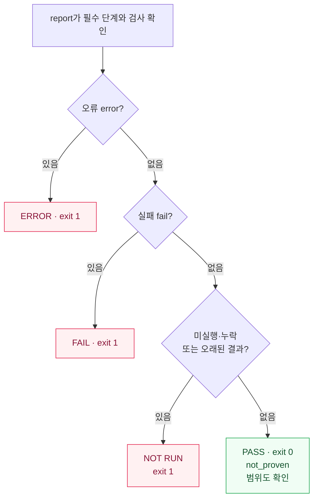

# 결과 읽기

이 문서는 README의 '결과 읽기' 절을 옮긴 참조 문서입니다(v0.27.0). 무엇을 증명하지 못하는지는 [README의 검증 한계와 not_proven](../../README.md#limitations-and-not-proven)에 있습니다.


각 단계의 `result.json`에는 `status`, `checks`의 ID·상태·`config_ref`·건수 정보, `not_proven`, `next_safe_action`이 들어갑니다.



| 표시 | 어떻게 읽는가 |
|---|---|
| `error` / `fail` | 검사 자체의 오류 또는 조건 불충족 |
| `not_run` | 실행하지 못했거나 제외된 검사 · **통과로 바뀌지 않음** |
| `not_proven` | 통과한 검사가 증명하지 못한 부분 · 판정과 함께 제시 |
| `config_ref` | 점검·수정할 `crosscheck.toml` 위치 |
| `next_safe_action` | 원인을 처리하고 다음에 수행할 행동 |

판정 우선순위는 **error → fail → not_run → 모두 pass**입니다. 자원 제한을 넘긴 SHACL·OWL도 `reason=resource_limit`과 명시적 `not_run`을 남깁니다. `--only`·`--gold`·`--hierarchy`·`--rule`로 좁힌 실행을 전체 검증의 완료 근거로 사용하지 않습니다.

`report`는 `build`·`cube`·`verify`를 요구합니다. 설정에 `[ontology]` 또는 `[[shapes]]`가 있으면 `reason`도 필요합니다. 의존 단계보다 먼저 실행한 결과는 오래된 것으로 처리합니다: `build`는 `demo` 뒤, `reason`·`cube`는 `build` 뒤, `verify`는 `build`·`cube` 뒤에 실행합니다. 선택 단계인 `doctor`·`demo`도 실행 결과가 실패이면 보고서를 실패시킵니다.

> [!IMPORTANT]
> 설정과 gold SQL의 fingerprint가 바뀌면 관련 결과는 `why=inputs_changed`로 오래된 상태가 됩니다. 데이터 버전 추적은 위의 선택 설정으로 연결할 수 있지만, **PostgreSQL·Cube의 모든 세션이 하나의 MVCC snapshot을 공유하지는 않습니다.** 한 번의 검증 동안 입력 데이터를 안정적으로 유지해야 합니다.

<a id="evidence-kinds"></a>
## 근거의 종류 읽기

0.23.0부터 모든 검사에는 근거의 종류가 하나 있습니다. 종류는 검사가 비교하는 두 쪽이 무엇인지를 말할 뿐, 어느 쪽이 옳다는 뜻은 아닙니다. 판정 규칙과 전체 표는 [설계 문서의 Evidence kinds](../../docs/design.md#evidence-kinds)에 있습니다.

| 종류 | 두 쪽 | 예 |
|---|---|---|
| `authored` | 한쪽이 사람이 쓴 gold SQL의 행이며, 그 SQL에 생성한 텍스트가 그대로 들어 있지 않음. 누가 썼는지만 말하며 gold SQL이 옳거나 설정과 독립이라는 뜻은 아님 | `v1:<gold>`, `v2:<gold>:<stratum>` |
| `recomputed` | 한쪽을 생성기 모듈을 가져오지 않는 엔진 코드가 원본 행에서 다시 계산. 생성기 코드와 독립일 뿐 설정 항목과 독립은 아님 | `v3:closure_oracle:<h>` |
| `generated` | 두 쪽 모두 `crosscheck.toml`에서 생성기로 만들었거나, 한 생성 계층을 자기 자신과 비교. 두 번째 엔진(HermiT)을 써도 입력을 생성기가 만들면 여기에 속함 | `v3:closure_oracle:<h>`를 뺀 `v3:*`, `shacl:<id>`, `v5:closure:<h>`, `closure_apply:<h>` |
| `structural` | 한쪽뿐: 데이터·설정·환경·제공된 모델에 대한 규칙, 실행 범위의 기록 | `shape:<id>`, `cube:meta`, `scope:v1` |
| `mutation` | V4 변이 검사. 무엇이 변이를 검출했는지는 `detection`에 따로 기록 | `v4:<operator>:<target>` |

gold SQL에 생성한 텍스트가 그대로 있으면(출력 스키마 이름, 생성한 관계의 이름 `<h>_closure`·`<h>_cycles`·`v_shape_<id>`·`v_rule_<id>`·`v_rules_subjects`, 지표 필터의 조건절을 그대로 옮긴 것) 그 gold 질의의 `v1`·`v2` 검사는 generated로 세고, verify가 무엇이 일치했는지 `not_proven` 줄로 알립니다. 규칙 뷰는 일치한 글자 대신 항상 한 항목 `relation:v_rule_*`로 적고, 대소문자는 ASCII 범위에서만 같게 봅니다. 표현을 바꿔 옮긴 복사는 찾지 못합니다.

**V4의 `detection`.** V4 suite는 사람이 쓴 gold 항목을 먼저, 생성한 텍스트가 있는 gold 항목을 그다음, V3 항목을 마지막에 실행하고 처음 통과하지 않은 항목에서 멈춥니다. `v4:<operator>:<target>` 검사의 detail에는 `killed_by`(처음 실패한 항목)와 함께 `detection`, `facet`(연산자가 바꾸는 부분), `gold_comparing`(그 facet을 비교하는 사람이 쓴 gold 질의)이 있습니다.

| `detection` | 뜻 |
|---|---|
| `authored` | 다시 실행한 사람이 쓴 gold 항목이 변형 모델에서 실패함. gold 질의가 이 변화를 검출했다는 표시는 이것뿐 |
| `generated_only` | 다시 실행한 사람이 쓴 gold 항목은 모두 통과했고, 생성 계층끼리의 검사(V3 항목 또는 생성한 텍스트가 있는 gold 항목)만 실패함. 기본 모드에서는 verify가 연산자별 처방을 담은 `not_proven` 줄을 남기고, `"require"` 모드에서는 그 줄 대신 검사가 `fail`이 되어 다음 할 일을 알림(suite 항목이 빠졌으면 `not_run`과 그 사실을 적은 줄) |
| `unattributed` | 어떤 근거 규칙도 분류하지 못한 항목이 실패함 |
| `none` | 실패한 항목이 없음(변이가 살아남음) |

다시 실행하는 항목은 V1의 첫 바인딩과 층마다 처음 `verify.mutant_bindings`개의 바인딩뿐이므로, `generated_only`는 이 바인딩에 대해서만 정확합니다. suite가 처음 실패한 항목에서 멈추므로 그 뒤의 항목도 검출했을지는 알 수 없습니다.

**report의 `EVIDENCE` 줄.** verify 결과가 있으면 `report`는 `report.json`에 `evidence` 키, `report.md`에 `## Evidence` 절을 쓰고, 콘솔의 `NOT PROVEN` 줄 뒤·`next:` 앞에 `  EVIDENCE  `로 시작하는 줄을 출력합니다(`--quiet`이면 출력하지 않음). 판정은 바꾸지 않습니다. 줄에는 다음이 나옵니다.

- 종류별 검사 수(통과/전체)와, authored 검사 중 양쪽 모두 0행을 비교한 수
- 변이: 선택한 연산자 수, 사람이 쓴 항목이 검출한 수, 생성 계층끼리의 검사만 검출한 수와 그 검사 ID, 귀속하지 못한 수, `verify.accepted_gaps`로 허용한 수, 살아남은 수, 판정하지 못한 수, 이 데이터에서 동등한 수, 적용할 수 없는 수
- facet: 사람이 쓴 gold SQL이 값이 있는 행으로 비교한 수, 사람이 쓴 항목의 변이 검출로 더해진 수, 사람이 쓴 근거가 없는 facet과 그 이유
- 0행: 양쪽 모두 0행을 비교한 authored 검사(이름이 `empty`인 층의 것은 따로), 모든 비교가 0행이었던 gold 질의, 생성한 텍스트가 있는 gold SQL

facet은 지표·계층·`ontology.class_column`에서 gold 질의가 비교할 수 있는 한 부분입니다(예: `m_<m>.value`, `m_<m>.ts`, `<h>_closure.qty`, 노드 cube와 지표의 조인 `<node>+m_<m>`; 모델의 어느 엔터티 cube에도 분류 열이 없으면 `*.<class_column>` 하나가 `not_in_model` 빈틈으로 남음). 행을 비교했어도 gold 쪽 값이 모두 NULL·0·빈 문자열이면 비교한 것으로 세지 않습니다. 값이 있는 행을 비교했다는 것도 틀린 값을 잡아낸다는 뜻은 아니며, 변화를 보았다는 근거는 사람이 쓴 항목의 변이 검출뿐입니다. facet은 범위를 좁히지 않은 verify 실행에서만 판정하고, 좁힌 실행에서는 `not judged (narrowed verify run)`으로 나옵니다.

**두 가지 모드.** `[verify] gold_observation`의 기본값 `"disclose"`는 알리기만 하고 상태를 바꾸지 않습니다. 예외가 하나 있습니다. gold SQL에 생성한 텍스트가 있으면 그 gold 항목은 V4 suite에서 사람이 쓴 항목 뒤로 가므로, 그런 설정에서는 `killed_by`와 V4 상태가 어느 쪽으로든(`error`·`not_run`이 `pass`로, `pass`가 `error`·`not_run`으로) 달라질 수 있습니다. 선택 값 `"require"`는 알리던 내용을 상태로 바꾸며, 통과를 실패나 `not_run`으로만 바꿉니다. 생성 계층끼리의 검사만 검출한 변이는 `fail`(`generated_only`, `unattributed`)이고 suite 항목이 빠졌으면 `not_run`(`suite_incomplete`), 전체 범위 실행에서는 지표·계층·`ontology.class_column`마다 `gold_evidence:<element>` 검사가 생기며, 모든 비교가 0행인 gold 질의의 통과한 `v1:<gold>`는 `not_run`(`no_rows_compared`)입니다. `error`는 바꾸지 않습니다. `verify.accepted_gaps`에 이미 아는 빈틈(요소, facet, `v4:<operator>:<target>`)을 적으면 그 항목은 실패하지 않고 `accepted by verify.accepted_gaps` 줄로 남습니다. 두 키는 [설정 레퍼런스](../../skills/semantic-crosscheck/references/config.md)에 있습니다.

<a id="reading-a-failure"></a>
## 실패한 실행 읽기

아래는 `build`의 검사 두 개가 실패했을 때의 콘솔 출력입니다. 테스트의 기준 출력 파일 [`build_fail/console.txt`](../../tests/fixtures/compat_v0_21_1/build_fail/console.txt)에서 그대로 옮겼습니다. 파일 첫 줄의 `exit 1`은 종료 코드 기록이라 뺐고, `<out>`은 출력 디렉터리 자리입니다. 이 출력은 데모 설정으로 `build`를 실행하되, 실제 DB 대신 고정된 합성 건수를 돌려주는 테스트용 연결을 써서 얻은 것입니다. 단위 테스트(`tests/test_data_rules_compat.py`)가 현재 코드의 출력과 바이트 단위로 같은지 확인합니다. 실제 DB에서 dirty 데모를 실행하면 심어 둔 결함이 더 많아 실패하는 검사가 더 많습니다.

```text
[sxc build] FAIL  checks: 4 pass, 2 fail, 0 error, 0 not_run  -> <out>/build/result.json
  FAIL    shape:child_exists  [shapes[0] child_exists]  violations=2 severity=violation kind=class view=sxc_out.v_shape_child_exists
  FAIL    shape:open_le_total  [shapes[3] open_le_total]  violations=3 severity=violation kind=sql view=sxc_out.v_shape_open_le_total trusted_sql=True
  NOT PROVEN  runtime evidence is unbound: actual PostgreSQL, Node, Java, HermiT and selected Cube installation were not bound; local engine/package metadata alone does not establish the executing runtime
  NOT PROVEN  data revision is unbound: no owner-maintained revision was checked; separate database sessions and cached gold answers are not proven to observe one data version
  next: shapes failed: inspect the violating keys in sxc_out.v_shape_child_exists, sxc_out.v_shape_open_le_total, then fix the data or the [[shapes]] entries; then rerun build
```

| 출력에서 볼 곳 | 읽는 법 |
|---|---|
| 첫 줄의 `4 pass, 2 fail, 0 error, 0 not_run` | 단계 판정과 검사 수입니다. 실패한 검사가 있어 단계가 FAIL이고 종료 코드는 1입니다. 통과한 검사 4개는 화면에 나오지 않으며(경고 등급이라 위반 1건을 보고하고 통과한 `shape:stock_nonnegative` 포함) 전체 목록은 `result.json`에 있습니다. |
| `shape:child_exists` | 실패한 검사의 ID입니다. |
| `[shapes[0] child_exists]` | `config_ref`, 곧 점검할 설정 위치입니다. `crosscheck.toml`의 `[[shapes]]` 항목을 0부터 세어 0번(첫 번째)이고 `id`가 `child_exists`입니다. |
| `violations=2`, `view=sxc_out.v_shape_child_exists` | 규칙을 어긴 행이 2건입니다. 행 값은 출력하지 않습니다. 어긴 행은 출력 스키마의 이 뷰에 있으므로 DB에서 조회합니다. |
| `kind=sql`, `trusted_sql=True` | 설정에 적은 `sql_violation` 조건으로 검사한 규칙이라는 표시입니다. |
| `NOT PROVEN` 두 줄 | 이 실행이 증명하지 못한 범위입니다. 통과한 실행에도 나오며 판정을 바꾸지 않습니다. |
| `next:` | 다음에 할 일입니다. 두 뷰에서 어긴 행의 키를 확인하고, 데이터나 `[[shapes]]` 항목을 고친 뒤 `build`를 다시 실행하라고 합니다. |

이 상태에서 `report`를 실행하면 최종 판정은 다음과 같습니다([`report_fail/console.txt`](../../tests/fixtures/compat_v0_21_1/report_fail/console.txt), 같은 실행의 [`report.md`](../../tests/fixtures/compat_v0_21_1/report_fail/report.md)).

```text
[sxc report] FAIL  checks: 0 pass, 1 fail, 0 error, 3 not_run  -> <out>/report/result.json
  FAIL    stage:build  [shapes[0] child_exists]  pass=4 fail=2 error=0 not_run=0 not_proven=2 required=True
  NOT_RUN stage:reason  reason=missing required=True
  NOT_RUN stage:cube  reason=missing required=True
  NOT_RUN stage:verify  reason=missing required=True
  NOT PROVEN  data revision is unbound: no owner-maintained revision was checked; separate database sessions and cached gold answers are not proven to observe one data version
  NOT PROVEN  stage doctor was not run, so the check role's privileges (read-only on the source tables) and the optional components were not verified
  next: fix build first (fail): shapes failed: inspect the violating keys in sxc_out.v_shape_child_exists, sxc_out.v_shape_open_le_total, then fix the data or the [[shapes]] entries; then rerun build
```

- `report`는 필수 단계마다 `stage:<name>` 검사를 하나씩 둡니다(선택 단계 `doctor`·`demo`는 판정에 쓸 결과가 있을 때만). `stage:build`는 build 결과의 검사 수를 다시 세어 FAIL로 판정하고, 대괄호에는 그 단계에서 처음으로 통과하지 못한 검사의 `config_ref`를 보여 줍니다.
- `NOT_RUN`과 `reason=missing`은 필수 단계 `reason`·`cube`·`verify`의 결과가 없다는 뜻입니다. 실행하지 않은 단계는 통과로 세지 않습니다.
- `next:`는 먼저 고칠 단계를 알려 줍니다. 여기서는 build의 `next:`를 그대로 되풀이합니다.

**다음에 할 일**

1. `view=`에 나온 뷰를 DB에서 사용자와 함께 조회해 어긴 행을 확인합니다. 예: `SELECT * FROM sxc_out.v_shape_child_exists;`
2. 데이터가 틀렸으면 원본 데이터를 고치고, 규칙이 틀렸으면 `config_ref`가 가리키는 `crosscheck.toml` 항목을 고칩니다. 생성된 SQL·YAML은 고치지 않습니다.
3. 실패한 단계(`build`)를 다시 실행한 뒤, 그 뒤의 단계(`reason`·`cube`·`verify`)와 `report`를 순서대로 실행합니다.
